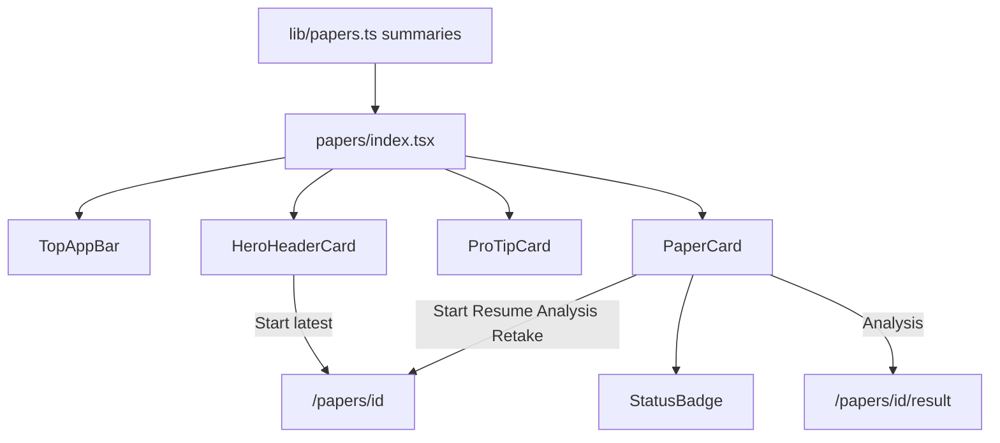

# Papers List UI Redesign

## Scope

**This pass:** redesign [`src/app/papers/index.tsx`](src/app/papers/index.tsx) only (list catalogue). Detail / session / result screens stay as-is.

**Out of scope:** BottomNav / tab architecture. Expo Tabs already has a Papers tab that pushes `/papers`; the stack screen will not re-implement the mockup bottom bar (avoids duplicate nav). Existing tab entry remains.

## Components to create / extend

| Component | Path | Reusable for |
|-----------|------|----------------|
| **HeroHeaderCard** | [`src/components/shared/HeroHeaderCard.tsx`](src/components/shared/HeroHeaderCard.tsx) | Any feature mission hero (papers, mocks, learn) |
| **ProTipCard** | [`src/components/shared/ProTipCard.tsx`](src/components/shared/ProTipCard.tsx) | Tips on home, practice, papers |
| **StatusBadge** | [`src/components/shared/StatusBadge.tsx`](src/components/shared/StatusBadge.tsx) | Status pills across catalogues |
| **PaperCard** | [`src/components/papers/PaperCard.tsx`](src/components/papers/PaperCard.tsx) | Papers list (and later mock-paper pickers) |
| **TopAppBar** (extend) | [`src/components/ui/TopAppBar.tsx`](src/components/ui/TopAppBar.tsx) | Add `subtitle` + `avatarUri` for mockup header |

### 1. `HeroHeaderCard` (new)

Props (data-driven, no papers-only coupling):

- `badgeIcon`, `badgeLabel`
- `title`, `description`
- `illustration` (ReactNode — use `MascotDisplay` on papers)
- `durationLabel?` (e.g. `150m` from latest paper duration)
- `stats`: three cells — `{ label, value, hint? }[]` plus optional third cell as CTA
- `ctaLabel`, `onCtaPress`, `ctaDisabled?`

Visual: rounded-3xl purple gradient panel (`#3B28CC` → `#583BE8` → `#7C3AED` via layered Views / SVG stops like home), decorative orbs, white copy, amber badge, bottom glass stats strip with embedded **Start Paper** button.

### 2. `ProTipCard` (new)

Props: `title`, `body`, `icon?` (default `verified`).

Matches mockup: `surface-container-low` + primary border, circular icon tile, bold primary title + muted body.

### 3. `StatusBadge` (new)

Props: `status: 'unattempted' | 'in_progress' | 'completed' | 'attempted'`, optional `label` override.

Styles from mockup:

- Unattempted — amber pill + dot
- In progress — amber / warn (functional; needed though mockup omits it)
- Completed — emerald + `check_circle`
- Attempted — amber + `check`

### 4. `PaperCard` (new)

Props:

- `title`, `subtitle?`
- `status` (+ badge)
- `isLatest?` → “Latest Exam” chip (`auto_awesome`)
- `metrics?`: score text + duration text (shown for completed/attempted)
- `accent?: 'none' | 'success' | 'warning'` → left border color
- Actions:
  - `primaryAction` / `secondaryAction` (`{ label, icon?, onPress, variant }`)

CTA layouts from mockup:

| Status | Accent | Actions |
|--------|--------|---------|
| Unattempted | none | full-width Start Paper |
| In progress | warning | full-width Resume |
| Completed (`submitted`) | success | Analysis + Re-attempt |
| Attempted (`abandoned`) | warning | full-width Re-take |

### 5. `TopAppBar` (extend)

Add optional `subtitle?: string` and `avatarUri?: string` under the brand row so papers can show `Official Archive • Class 6` without a one-off header. Keep existing parent-dashboard usage unchanged.

---

## Screen composition ([`src/app/papers/index.tsx`](src/app/papers/index.tsx))

Replace the custom avatar row + flat mission `Card` + stat tiles + inline paper cards with:

```text
TopAppBar (subtitle = Official Archive • Class N)
ScrollView
  HeroHeaderCard (totals / solved / Start Paper)
  ProTipCard
  PaperCard[] (year desc)
  Load more (if needed)
```

**Remove** year/Recent filter chips from this screen to match the mockup (list stays year-sorted; pagination kept).

### Status + CTA mapping (functionality)

Use attempt summaries from `fetchMyPaperAttemptSummaries`:

| Attempt | UI status | Primary nav |
|---------|-----------|-------------|
| none | unattempted | `/papers/[id]` |
| `in_progress` | in_progress | `/papers/[id]` (detail resumes) |
| `submitted` | completed | Analysis → `/papers/[id]/result?attemptId=…`; Re-attempt → `/papers/[id]` |
| `abandoned` | attempted | Re-take → `/papers/[id]` |

Hero **Start Paper** → latest paper (`papers[0]`), same as today.

Hero stats from live data:

- Total: `papers.length` + year span (`min–max`)
- Solved: count of `submitted` summaries; pending = rest
- Duration badge: latest paper `duration_minutes`

Score line: `Score: {total}/{max} ({pct}%)` and `Math.round(time_spent_seconds/60)` mins when available.

`isLatest`: `paper.id === papers[0]?.id`.

---

## Supporting updates

- **i18n** ([`src/lib/i18n.ts`](src/lib/i18n.ts)): strings for hero title/body, NTA badge, pro tip, Latest Exam, Analysis, Re-attempt, Re-take, Completed, status hints.
- **Types**: extend `PaperListStatus` to `'unattempted' | 'in_progress' | 'completed' | 'attempted'` and use a small `getPaperListStatus(summary)` helper in the screen or [`src/lib/papers.ts`](src/lib/papers.ts).
- **Icons**: already present (`history_edu`, `verified`, `auto_awesome`, `military_tech`, `analytics`, `replay`, `check_circle`).
- **Styling**: follow existing shared UI pattern — `StyleSheet` + `COLORS` / `TYPOGRAPHY` (like `TopAppBar`), compose with `MaterialIcon` + `Button` where CTAs need the tactile primary button; keep NativeWind light on the screen shell only.



## Verification

- List loads with hero totals / solved matching attempts
- Unattempted / completed / attempted / in-progress cards render correct badges, borders, and buttons
- Latest paper shows Latest Exam chip
- Pull-to-refresh still works; empty/error states unchanged
- TopAppBar still works on parent dashboard (no regressions)